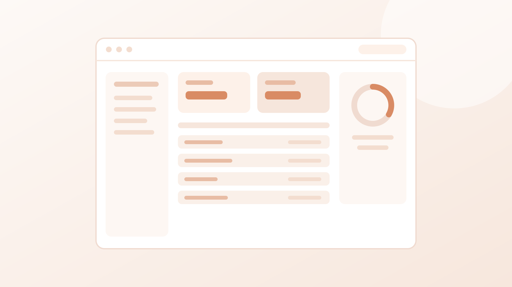

# Portofolio — Silvyani Nurlaila Husnina Fajrin

Website portofolio pribadi, dibangun dengan **HTML + CSS murni**, ditambah satu
skrip kecil (±30 baris) yang tugasnya cuma menandai menu yang sedang dilihat.
Tanpa framework, tanpa build tool — cukup buka `index.html`.

Pendekatannya **storytelling + evidence-first**: setiap poin pengalaman langsung
ditemani buktinya, bukan dikumpulkan di section terpisah.

## Cara membuka

Klik dua kali `index.html`, atau:

```
C:\New folder\Portofolio-Silvyani\index.html
```

---

## Urutan halaman

```
1. Profil                   nama, foto, peran, ringkasan perkenalan (menyentuh
                            3 peran: analisis → koordinasi → prioritas). Tombol
                            WhatsApp / Email / LinkedIn dan baris lokasi sengaja
                            TIDAK ada — kontak cukup di bagian akhir
2. Pengalaman               satu section (`#pengalaman`), tanpa judul section —
                            langsung kelompok "Pengalaman Kerja". Isinya HANYA
                            pekerjaan penuh waktu (Sasana, Lakes, Ganesha); tiap
                            pekerjaan punya deretan kartu bukti, dan kalimat
                            pekerjaannya jadi keterangan di dalam kartu, bukan
                            daftar poin terpisah
3. Proyek                   satu section sendiri (`#proyek`), tanpa baris
                            penjelas — hanya judul "Proyek". Setiap proyek =
                            satu kartu `.project-card`: pratinjau gambar di
                            atas, judul lengkap, keterangan singkat, dan
                            tombol **Buka di GitHub** di dasar kartu (aktif
                            begitu URL repo diisi).
                            Berisi 4 kartu: Aplikasi Survei Layanan (magang
                            Kemenag), Tugas Akhir visualisasi, plus 2 slot
                            proyek Web & Mobile. Tanggal proyek tidak
                            dicantumkan lagi.
4. Sertifikasi              satu-satunya bagian yang menampilkan GAMBAR
                            sertifikat — bentuk kartunya sama dengan kartu bukti
                            di Pengalaman (gambar di atas, keterangan di bawah).
                            Tersusun 2 per baris, sisa barisnya rata tengah.
                            Isinya BNSP, TOEFL, CCNA 1 & 2. Tanpa baris penjelas
                            dan tanpa label kecil di atas judul — judul saja
5. Pendidikan               dua kartu berdampingan (`.timeline--edu`), bentuk
                            kepalanya sama dengan kartu Pengalaman: nama
                            institusi → logo → jurusan → periode. Universitas
                            Komputer Indonesia (Teknik Informatika) dan SMK
                            Pasundan 1 Banjaran (Teknik Komputer dan Jaringan).
                            Di dalam tiap kartu ada dua kartu dokumen: "IPK"
                            (3.64 / 4.00, `b2` magang Kemenag di bawahnya), lalu
                            "Nilai Rata-rata" (83 / 100, `b3` magang Mitra Trend
                            di bawahnya)
6. Kontak                   WhatsApp, email, LinkedIn — tiga bulatan dalam satu
                            baris, tanpa alamat. Tombol CV ada di footer
                            (sebelah "Kembali ke atas")
```

> Section "Sorotan angka" (IPK, jumlah posisi, jumlah konten) sudah **dihapus** —
> isinya 100% mengulang bagian lain: IPK ada di Pendidikan, jumlah konten ada di
> Pengalaman, BNSP ada di Sertifikasi dan kartu `b1`. Menghapusnya membuat halaman
> lebih pendek tanpa kehilangan satu informasi pun.
>
> Section "Keahlian" juga sudah **dihapus** — seluruh tag-nya (PRD, Change Request,
> Balsamiq, functional testing, UAT, SQL/PostgreSQL, validasi API, analisis akar
> masalah, ticketing, training, feedback & NPS, reporting, koordinasi) sudah muncul
> di ringkasan hero dan poin-poin Pengalaman Kerja. Tidak ada satu kata kunci pun
> yang hilang, tapi halaman jadi jauh lebih pendek.
>
> Section "Tentang Saya / Sekilas" juga sudah **dihapus**. Isinya (Bidang, jumlah
> posisi, arah karier, status) mengulang hero dan bagian lain. Kartu domisili yang
> dulu dipindah ke Kontak pun **ikut dihapus** — alamat lengkap tidak perlu tampil
> publik. Dengan begitu halaman ini benar-benar jadi *detail di balik CV* — bukan
> CV kedua.
>
> Section "Cara Saya Bekerja" (3 kartu alur kerja) menyusul **dihapus** — isinya
> (akar masalah, PRD/CR/Balsamiq, functional testing, UAT, SQL, API) sudah tercakup
> di ringkasan hero dan poin-poin Pengalaman Kerja.
>
> Strip logo "Berpengalaman di" juga **dihapus**. Nama tiap perusahaan sudah tertulis
> jelas di kartu pengalaman masing-masing, jadi strip-nya cuma mengulang. File
> logonya masih tersimpan di `assets/logo/` kalau nanti mau dipakai lagi.
>
> Section **"Portofolio"** dulu dibubarkan karena buktinya ditempel langsung ke poin
> pengalaman. Sekarang nama itu tidak dipakai lagi: Pengalaman Kerja berdiri sendiri
> sebagai `#pengalaman`, dan karya terpisah di `#proyek`.
>
> Judul teks **"Rekam jejak / Portofolio"** di atas section itu **dihapus** supaya
> tidak mengulang tautan menu, dan **tautan menunya bernama "Pengalaman"**
> (dulu "Portofolio") supaya cocok dengan isinya. Section-nya sendiri tetap ada
> (`id="pengalaman"`), jadi klik menu itu tetap meluncur ke Pengalaman Kerja.

## Cara bukti ditampilkan sekarang

Bagian **Pengalaman Kerja** ditulis seperti **portofolio**: tiap peran punya
deretan kartu bukti, dan kalimat pekerjaan dari CV langsung jadi *keterangan* di
dalam kartunya — bukan daftar poin terpisah.

Ada dua gaya penempatan kartu:

- **Sasana Solusi Digital** — 6 kartu bukti berisi gambar, ditaruh **di bawah**
  nama peran, menggantikan poin-poin CV sepenuhnya.
- **Lakes & Ganesha** — buktinya berupa surat keterangan berbentuk **PDF**
  (`target="_blank"`, jadi kebuka di tab baru), ditaruh **di bawah** poin-poin
  kerja: pembaca kenal dulu isi kerjanya, buktinya menyusul sebagai penutup.

**Tidak ada lagi kelompok "Pengalaman Magang".** Atas permintaan Silvyani, isi
magang dipindah ke tempat yang sesuai dengan bentuknya:

- **Kemenag** → jadi kartu di bagian **Proyek** (`p2`, *Aplikasi Survei
  Layanan*), lengkap dengan keterangan "Kantor Kementerian Agama Kota Bandung ·
  Sep–Okt 2023" dan tombol *Lihat sertifikat*.
- **Sertifikat magang Kemenag & Mitra Trend** (`b2`, `b3`) → pindah ke bagian
  **Pendidikan**, di dalam kartu institusinya (Kemenag di kartu UNIKOM, Mitra
  Trend di kartu SMK). Alasannya: keduanya meninggalkan dokumen pelatihan, bukan
  kredensial profesi seperti BNSP atau CCNA.
- **Mitra Trend** tidak punya proyek yang bisa dipamerkan (kerja harian
  dukungan teknis), jadi jejaknya tinggal di sertifikatnya.

> Alasannya: pengalaman kerja punya surat keterangan, sedangkan magang
> meninggalkan sertifikat dan proyek. Jadi pembagiannya sekarang bersih —
> **Pengalaman = di mana saya bekerja · Proyek = apa yang saya buat ·
> Sertifikasi = kredensial profesi · Pendidikan = riwayat sekolah + lampirannya.**
> Tidak ada satu bukti yang muncul di dua tempat.

Sisa jejak kode lama: `.timeline--pair` (dua kolom untuk magang) sudah dihapus
dari `style.css`; kalau nanti butuh dua kartu pengalaman berdampingan lagi,
cukup tambahkan kembali aturan `grid-template-columns` untuk `.timeline`.

Kalau satu kalimat pekerjaan sebenarnya berisi dua hal dengan bukti berbeda
(misalnya *webinar* dan *training*), kalimatnya **dipecah** dan tiap bagian
dapat kartunya sendiri.

Deretan kartunya memakai **grid 2 kolom** dengan lebar baris dibatasi 940 px,
jadi jumlah kartunya per baris **selalu 2 (kiri-kanan), dan 1 di HP (≤620px)** —
berapa pun lebar layarnya. Kartu terakhir yang jumlahnya ganjil **dipusatkan di
tengah** dengan ukuran yang sama seperti kartu lain (bukan dilebarkan), jadi
barisnya tidak nyangkut sendirian di kiri. Bagian yang cuma punya satu kartu
(surat Lakes/Ganesha, sertifikat magang) otomatis ikut terpusat dan melebar
selebar kartunya — bukan selebar halaman.

| Sifat | Tampilan | Aksi |
|---|---|---|
| **Terbuka** — sertifikat, piagam, artikel, video, training, NPS | kartu penuh (gambar + label + judul + deskripsi) | gambar diklik → lightbox |
| **Terbatas** — dokumen internal perusahaan *(pola siap pakai, sekarang belum dipakai)* | kartu bergaris putus-putus + label *Terbatas* dan catatan *"Ditunjukkan saat proses interview"* | **tidak bisa diklik** |

Pemetaan tiap bukti:

| Bukti | Menempel di poin |
|---|---|
| `b12` respons support *(komposit testimoni + ringkasan support, + tautan reel Instagram)* | Sasana — "Menangani & menganalisis issue" |
| `b11` hasil survei NPS *(gambar + tombol lihat grafik)* | Sasana — "Menganalisis feedback pengguna" |
| `b10` poster dokumentasi training | Sasana — "Melakukan training" |
| `b5` artikel panduan *(+ tautan user guide)* | Sasana — "Membuat artikel panduan" |
| `b6` video panduan *(+ tautan playlist YouTube)* | Sasana — "Membuat video panduan" |
| `b4` poster narasumber webinar *(+ rekaman YouTube)* | Sasana — "Melakukan webinar" |
| Surat keterangan pelatihan **(PDF, buka tab baru, di atas poin)** | Lakes |
| Surat keterangan kerja **(PDF, buka tab baru, di atas poin)** | Ganesha |
| `b2` sertifikat magang Kemenag | kartu Pendidikan (kartu UNIKOM) *(juga ditautkan dari proyek `p2`)* |
| `b3` sertifikat magang Mitra Trend | kartu Pendidikan (kartu SMK) |
| `b1` sertifikat BNSP | kartu Sertifikasi |
| `b13` sertifikat CCNA 1 | kartu Sertifikasi |
| `b14` sertifikat CCNA 2 | kartu Sertifikasi |
| `b16` TOEFL *(kartu teks, gambarnya menyusul)* | kartu Sertifikasi |

Dokumen internal **tidak memakai gambar sama sekali** — kalau dipratinjau, isinya
tetap tidak terbaca dan cuma memakan tempat. Kalau nanti ada dokumen yang perlu
ditampilkan, bentuknya kartu teks: label *Terbatas*, judul, keterangan singkat,
lalu catatan *"Ditunjukkan saat proses interview"*. Kartunya sengaja tidak bisa
diklik. Sekarang tidak ada kartu seperti ini di halaman — pola dan CSS-nya
(`.proof--locked`, `.proof__tag--locked`, `.proof__note`) tetap disediakan kalau
suatu saat diperlukan.

Khusus dua surat, kartunya **bisa diklik**: tombolnya membuka file PDF di tab
baru. Isinya:

| Kartu | File |
|---|---|
| Lakes — Surat Keterangan Pelatihan | `assets/bukti/surat-keterangan-pelatihan.pdf` |
| Ganesha — Surat Keterangan Kerja | `assets/bukti/surat-keterangan-kerja.pdf` |

---

## Posisi yang dituju

Hero menampilkan tiga peran, disusun bertahap:

| Peran | Alasan |
|---|---|
| **Business Analyst** | Kekuatan analisis & dokumen rancangan (PRD, CR, UAT, validasi SQL) dari Ganesha Operation. Judul "analyst" yang paling luas lowongannya. |
| **Project Manager** | **Arah karier** menuju manajerial di sisi penyampaian proyek. Lihat catatan risiko di bawah. |
| **Product Owner** | Pemilik keputusan produk. Sambungan langsung dari kerja PRD, CR, dan UAT di Ganesha Operation. |

Kalimat **"Menuju kepemimpinan produk"** yang dulu ditulis di kartu Sekilas sudah
ikut terhapus bersama kartunya.

Hero **tidak** memakai pil "terbuka untuk posisi ..." — atas permintaan, supaya tidak terkesan mencari-cari.

**Nada bahasa.** Semua teks ditulis dalam bahasa Indonesia **baku dan formal**,
tetapi dengan sedikit sentuhan hangat dan personal supaya terdengar seperti
orangnya, bukan seperti brosur perusahaan. Caranya: kalimat pembuka hero dan
kontak memakai **kata ganti "saya"**, dan ada satu-dua kalimat yang menunjukkan
selera kerjanya (mis. *"saya senang membereskan alur yang berbelit"*). Aturan
praktisnya: **tetap baku, tanpa bahasa gaul** ("banget", "ngobrol", "kek"). Kalau
mau menambah kehangatan di bagian lain, ikuti pola itu — deskripsi bukti dan poin
pekerjaan tetap faktual dan tanpa bumbu.

> **Catatan risiko — Project Manager.** Ini klaim paling berani di antara ketiganya.
> Bukti kepemimpinan proyek (mengatur jadwal, lingkup, dan anggaran) belum ada di portofolio;
> yang ada baru koordinasi teknis dan pendampingan implementasi. Jadi judul ini dipakai
> sebagai **arah**, bukan pencapaian. Kalau targetmu perusahaan besar, ganti jadi
> **Delivery Manager** atau **Project Coordinator** — tetap terbaca manajerial, tapi tidak
> bisa dipatahkan saat interview.

> **Kenapa bukan Product Manager?** Karena kalau ditulis bersama Product Owner, dua kata
> "Product" berdampingan membuat keduanya terbaca tumpang tindih — di banyak perusahaan
> keduanya memang orang yang sama. Recruiter yang paham produk bisa membacanya sebagai
> "belum tahu bedanya".

> **Yang sengaja tidak ditulis:** Head of Product, IT Project Manager, Director.
> Klaim level itu di pengalaman ±2 tahun langsung terbaca menggelembung.

Mau ganti? Cukup satu baris di `index.html`. Tiap peran dibungkus
`.hero__role-item` supaya pemisahnya tidak menggantung di ujung baris, dan di
layar ≤480px ketiganya otomatis ditumpuk (titik pemisah disembunyikan):

```html
<p class="hero__role">
  <span class="hero__role-item">Business Analyst<i class="sep" aria-hidden="true">&bull;</i></span>
  <span class="hero__role-item">Project Manager<i class="sep" aria-hidden="true">&bull;</i></span>
  <span class="hero__role-item">Product Owner</span>
</p>
```

Daftar peran lain yang bisa ditukar: System Analyst, Implementation Consultant,
Functional Consultant, Associate Product Manager, Product Analyst, Data Analyst,
QA/Test Analyst, Technical Writer, Delivery Manager, Project Coordinator.

Sesuaikan juga kalimat di bagian **Kontak**.

**Aturan penulisan yang dipakai:** judul jabatan resmi (Technical Support, IT Helpdesk)
ditulis apa adanya karena bisa dicek lewat surat kerja — yang digeser adalah **kata kerja**
pada poin-poinnya: dari *menangani / melayani / merespons* menjadi
*menganalisis / merancang / memvalidasi*.

---

## Struktur folder

```
Portofolio-Silvyani/
├── index.html                 struktur & seluruh konten
├── style.css                  tampilan (tema terracotta hangat)
├── README.md                  catatan ini
├── siapkan-gambar.bat         >>> KLIK DUA KALI INI setelah taruh gambar
├── siapkan-gambar.ps1         mesin pengolah gambar (dipanggil oleh .bat)
├── buat-placeholder.ps1       skrip pembuat gambar contoh (boleh dihapus)
├── tambah-placeholder.ps1     skrip penambah gambar contoh (boleh dihapus)
└── assets/
    ├── foto-profil.jpg        >>> FOTO PROFIL DI HERO (masih contoh, timpa saja)
    ├── _mentah/               >>> TARUH GAMBAR MENTAH DI SINI
    │   └── BACA-INI-DULU.txt  daftar kode b1-b20 dan l1-l5
    ├── logo/                  LOGO PERUSAHAAN (dipasang di lencana bulat)
    │   ├── sasana-solusi-digital.png   320x320, sudah dipotong pinggirannya
    │   ├── lakes-konstelasi-data.png   320x320, sudah dipotong pinggirannya
    │   ├── ganesha-operation.png       320x320, sudah dipotong pinggirannya
    │   └── *.svg                        strip lama dari bagian "Berpengalaman
    │                                    di" yang sudah dihapus (tidak dipakai)
    └── bukti/                 gambar bukti
        ├── sertifikat-bnsp.jpg          → b1  sertifikat BNSP
        ├── sertifikat-ccna-1.jpg        → b13 CCNAv7: Introduction to Networks
        ├── sertifikat-ccna-2.jpg        → b14 CCNAv7: Switching, Routing, and
        │                                      Wireless Essentials
        ├── sertifikat-toefl.jpg         → b16 TOEFL (belum ada, kartunya
        │                                      sementara berupa kartu teks)
        ├── sertifikat-kemenag.svg       → b2  magang Kemenag
        ├── sertifikat-mitra-trend.svg   → b3  magang Mitra Trend
        ├── webinar-piagam.jpg           → b4  poster narasumber webinar
        ├── artikel-tantri-pos.jpg       → b5  sampul artikel panduan
        ├── video-panduan.jpg            → b6  sampul playlist video panduan
        ├── training-pengguna.jpg        → b10 poster dokumentasi training
        ├── laporan-nps.svg              → b11 grafik hasil survei NPS
        ├── testimoni-tului-ngopi.jpg    → sumber komposit b12 (sampul testimoni)
        ├── respons-support.jpg          → b12 komposit testimoni + ringkasan support
        ├── surat-keterangan-pelatihan.pdf  → kartu surat di Lakes (PDF asli)
        ├── surat-keterangan-kerja.pdf      → kartu surat di Ganesha (PDF asli)
        └── (dokumen internal tidak memakai gambar)
```

---

## Cara memasukkan gambar asli (SENDIRI, tanpa ribet)

Sebagian file di `assets/` masih berupa **placeholder** (gambar contoh abu-abu
terracotta). Yang sudah memakai gambar asli: kartu `b1` (sertifikat BNSP),
`b4` (poster webinar), `b13` & `b14` (CCNA 1 & 2), plus ketiga logo perusahaan.
Kartu `b5` dan `b6` memakai **sampul buatan sendiri** (bukan screenshot apa
adanya): visual perangkat Tantri dengan teks yang disesuaikan, supaya tetap ada
gambarnya tanpa memakai teks promo atau thumbnail satu video yang judulnya
berbeda.
Gambar aslinya dimasukkan lewat folder **penampungan**:

```
assets\_mentah\        <-- taruh gambar mentah di sini
```

### Langkah-langkah

1. **Beri nama file sesuai kode.** Huruf kecil/besar bebas, ekstensi bebas.

   | Kode | Untuk apa | Jadi file |
   |---|---|---|
   | `b1` | Sertifikat BNSP | `bukti\sertifikat-bnsp.jpg` |
   | `b2` | Sertifikat magang Kemenag | `bukti\sertifikat-kemenag.jpg` |
   | `b3` | Sertifikat magang Mitra Trend | `bukti\sertifikat-mitra-trend.jpg` |
   | `b4` | Foto narasumber webinar | `bukti\webinar-piagam.jpg` |
   | `b5` | Artikel panduan Tantri POS | `bukti\artikel-tantri-pos.jpg` |
   | `b6` | Video panduan | `bukti\video-panduan.jpg` |
   | `b7` | Laporan magang Kemenag *(opsional)* | `bukti\laporan-magang-kemenag.jpg` |
   | `b8` | Laporan magang Mitra Trend *(opsional)* | `bukti\laporan-magang-mitra-trend.jpg` |
   | `b10` | Poster dokumentasi training pengguna | `bukti\training-pengguna.jpg` |
   | `b11` | Grafik hasil survei NPS | `bukti\laporan-nps.svg` |
   | `b12` | Respons support (komposit testimoni + ringkasan support) | `bukti\respons-support.jpg` |
   | `b13` | Sertifikat CCNA 1 | `bukti\sertifikat-ccna-1.jpg` |
   | `b14` | Sertifikat CCNA 2 | `bukti\sertifikat-ccna-2.jpg` |
   | `b15` | Sertifikat keempat (kredensial) | `bukti\sertifikat-keempat.jpg` |
   | `b16` | Sertifikat TOEFL | `bukti\sertifikat-toefl.jpg` (gambar menyusul) |
   | `b17` | Gambar proyek 1 | `bukti\proyek-1.jpg` |
   | `b18` | Gambar proyek 2 | `bukti\proyek-2.jpg` |
   | `b19` | Gambar proyek 3 | `bukti\proyek-3.jpg` |
   | `b20` | Gambar proyek 4 | `bukti\proyek-4.jpg` |
   | `l1` | Logo Sasana Solusi Digital | `logo\sasana-solusi-digital.png` (320x320) |
   | `l2` | Logo Lakes Konstelasi Data | `logo\lakes-konstelasi-data.png` (320x320) |
   | `l3` | Logo Ganesha Operation | `logo\ganesha-operation.png` (320x320) |
   | `l4` | Logo Kemenag Kota Bandung | `logo\kemenag-bandung.png` (320x320) |
   | `l5` | Logo Mitra Trend Computer | `logo\mitra-trend-computer.png` (320x320) |

   Contoh: file piagam webinar cukup dinamai `b4.jpg` — tidak perlu dipotong
   atau di-resize manual. Logo perusahaan (l1-l5) juga begitu: kirim apa adanya,
   skrip yang memotong pinggirannya dan menyamakan ukurannya.

2. **Taruh di `assets\_mentah\`.**

3. **Klik dua kali `siapkan-gambar.bat`** di folder utama.

4. **Selesai.** Refresh browser dengan `Ctrl+F5`.

> **Kalau sertifikatnya PDF.** Skrip gambar hanya bisa membaca gambar
> (jpg, png, webp, dll), bukan PDF. Jadi PDF **tidak** ditaruh di
> `assets\_mentah\` — kirim saja file PDF-nya, halaman pertamanya digambar
> dulu jadi PNG, baru masuk ke alur yang sama seperti di atas. Contoh yang
> sudah jalan: **Sertifikat CCNA 1 & 2** (dulu PDF, sekarang tampil sebagai
> `bukti\sertifikat-ccna-1.jpg` dan `bukti\sertifikat-ccna-2.jpg`).
> PDF aslinya disimpan di `assets\_mentah\b13.pdf` dan `b14.pdf` sebagai
> sumber, dan tidak ikut dipublikasikan di halaman.

### Yang dikerjakan skrip otomatis

- ✅ **Perbaiki orientasi foto** — membaca data EXIF, jadi foto HP yang miring
  otomatis ditegakkan. Tidak akan ada sertifikat yang tampil rebah.
- ✅ **Skalakan dokumen apa adanya** (mode *fit*, kini jadi standar) — gambar
  **tidak dipotong** dan **tidak ditambahi kanvas kosong**; hanya sisi
  terpanjangnya dibatasi 1600 px. Jadi sertifikat tegak tetap besar saat
  diperbesar. Logo dipotong pinggiran kosongnya lalu dibuat **320 × 320 px**
  (kotak) dengan latar transparan, supaya tandanya tampil besar dan seragam
  di lencana bulat.
- ✅ **Kompres** ke JPEG kualitas 85 (logo tetap PNG transparan).
- ✅ **Rename** sesuai daftar di atas.
- ✅ **Perbarui `index.html`** di semua tempat (thumbnail **dan** lightbox) —
  tidak perlu edit manual. Cadangan lama otomatis disimpan sebagai `index.html.bak`.

### Kalau ingin mengubah setelan

Buka PowerShell di folder utama:

```powershell
.\siapkan-gambar.ps1                 # setelan standar (mode fit)
.\siapkan-gambar.ps1 -Mode pad       # dipaksa kanvas 1600 x 900 (16:9) + bingkai kosong
.\siapkan-gambar.ps1 -Mode crop      # kanvas penuh, pinggiran terpotong
.\siapkan-gambar.ps1 -Quality 75     # file lebih kecil, kualitas turun
```

- **`fit`** (standar) — bentuk asli dipertahankan, tanpa kanvas kosong.
  **Terbaik untuk sertifikat & dokumen**, termasuk yang tegak.
- **`pad`** — dipaksa jadi 1600 × 900 (16:9) dengan bingkai kosong di sekelilingnya.
- **`crop`** — memenuhi kanvas, pinggir terpotong. Bagus untuk **foto**, jelek untuk dokumen.

Semua kartu bukti menampilkan gambar **apa adanya, penuh** (`.proof__media img
{ width: 100%; height: auto }`) — jadi tidak ada lagi bingkai/pita latar di
atas-bawah gambar. Akibatnya tinggi gambar mengikuti rasio aslinya: poster 4:3
lebih tinggi, sampul 16:9 lebih pendek.

---

## Aturan gambar

| Aturan | Keterangan |
|---|---|
| **Ukuran** | Tidak perlu diatur — skrip yang menyesuaikan ke 1600 × 900 px. |
| **Resolusi minimal** | Usahakan **sisi terpanjang ≥ 1000 px** supaya tidak pecah saat diperbesar di lightbox. |
| **Format** | `.jpg`, `.jpeg`, `.png`, `.webp`, `.bmp`, `.gif`, `.tif`, `.tiff`. |
| **Hasil akhir** | Otomatis, biasanya 80–300 KB per gambar. |
| **Nama file** | Bebas, yang penting diawali kode (`b4.jpg`, `l3.png`). |

### ⚠️ Checklist sensor sebelum upload

- [ ] Nama client / merchant
- [ ] Harga, nominal transaksi, angka penjualan
- [ ] Data pelanggan (nama, nomor telepon, alamat)
- [ ] Data karyawan internal
- [ ] Tanda tangan, nomor sertifikat, dan QR code pada piagam
- [ ] URL internal, alamat server, atau token API
- [ ] Logo / watermark pihak ketiga yang tidak berkaitan

Kartu dokumen internal (system design) dan kartu surat keterangan **tidak
memakai gambar**, jadi tidak ada yang perlu disensor di `assets/`. Semuanya
dipresentasikan langsung saat interview.

---

## Tautan artikel, video, webinar & testimoni

Empat kartu di deretan Sasana Solusi Digital sudah memakai tautan asli:

| Kartu | Tautan |
|---|---|
| Artikel Panduan & Basis Pengetahuan | `https://tantri.id/user-guide` |
| Video Panduan & Onboarding Pengguna | `https://www.youtube.com/playlist?list=PLdjxc7qAYbt_Daw1TVf49DUvS5L2t0mmz` |
| Webinar Pengelolaan Shift & Absensi | `https://youtu.be/oRsaPGg0RFY` |
| SLA Support & Penanganan Tiket | `https://www.instagram.com/reel/DdoCma1x6Qi/` |

Semuanya dibuka di tab baru (`target="_blank" rel="noopener"`). Kalau URL-nya
berubah, cari kartunya di `index.html` lalu ganti `href` pada `.proof__link`:

```html
<a class="proof__link"
   href="https://tantri.id/user-guide"
   target="_blank" rel="noopener">Buka artikel</a>
```

Tombol pada **kartu gambar** (`b5`, `b6`, `b4`, `b12`) membuka tautan asli.
Gambar kartunya tetap bisa diklik untuk pratinjau (lightbox) seperti kartu bukti
lain — dua aksi berbeda: gambar = pratinjau, tombol = tautan luar, dan grafik NPS
(`b11`) dibuka lewat klik gambarnya.

Sampul `b5` (`assets/bukti/artikel-tantri-pos.jpg`) dan `b6`
(`assets/bukti/video-panduan.jpg`) dibuat khusus dengan palet yang sama seperti
halaman. `b5` memakai visual perangkat Tantri dengan judul **Artikel Panduan /
Panduan Pengguna Tantri POS**; `b6` berisi judul playlist dan tombol play. Kalau
nanti mau diganti dengan screenshot asli, cukup timpa file itu (nama sama).

`b10` memakai poster kolase dua foto training on-site dengan teks yang ringkas
(badge, judul, dan satu baris keterangan). `b12` menggabungkan sampul testimoni
pengguna **Tului Ngopi** (percakapan asli) dengan ringkasan support: **75%
tiket selesai, 351 tiket beres, 428 tiket direspons, first response 26 menit**.
Angka diambil dari dashboard support; tampilan internal dashboard itu sendiri
sengaja tidak ditampilkan di halaman (hanya angkanya yang diringkas). Klik
gambar untuk pratinjau versi besar. Grafik `b11`
memakai palet Tantri dan hanya memuat **Februari–Agustus 2026** (70 respons,
rata-rata 92%).

---

## Menambah bukti baru

**Menambah kartu bukti** — salin salah satu contoh ini ke dalam
`<div class="proof-row">` milik pekerjaan yang bersangkutan:

```html
<article class="proof" id="b14">
  <h4 class="proof__title">Judul bukti</h4>
  <a class="proof__media" href="#b14-lb" aria-label="Perbesar: Judul bukti">
    
  </a>
  <div class="proof__body">
    <span class="proof__tag">Kategori</span>
    <p class="proof__desc">Keterangan singkat — di sini ditulis kalimat pekerjaannya.</p>
    <a class="proof__link" href="#b14-lb">Buka</a>
  </div>
</article>
```

Judul selalu jadi **kepala kartu** — `<h4 class="proof__title">` diletakkan
langsung di dalam `.proof`, **di atas gambarnya** (bukan di dalam
`.proof__body`). CSS `.proof > .proof__title` yang memberi latar hangat dan
garis pemisahnya, jadi cukup ikuti urutan di atas.

Untuk bukti **terbatas** (dokumen internal), **tanpa gambar** — pakai tambahan
kelas `proof--locked proof--doc` dan langsung isi `proof__body`-nya saja
*(pola ini sekarang belum dipakai di halaman, tapi CSS-nya tetap ada)*:

```html
<article class="proof proof--locked proof--doc">
  <h4 class="proof__title">Judul dokumen</h4>
  <div class="proof__body">
    <span class="proof__tag proof__tag--locked">Terbatas</span>
    <p class="proof__desc">Satu baris keterangan singkat.</p>
    <p class="proof__note">Ditunjukkan saat proses interview.</p>
  </div>
</article>
```

Kartu seperti ini tidak punya `id` dan tidak punya lightbox, karena memang
tidak bisa diklik.

Kalau kartunya mau **bisa diklik** (misalnya membuka PDF di tab baru), `<article>`
diganti `<a>` dan kartunya diberi `href` — tanpa `proof--locked`:

```html
<a class="proof proof--doc" href="assets/bukti/nama-file.pdf" target="_blank" rel="noopener">
  <h4 class="proof__title">Judul surat</h4>
  <div class="proof__body">
    <span class="proof__tag">Surat</span>
    <p class="proof__desc">Satu baris keterangan singkat.</p>
    <span class="proof__link">Buka surat (PDF)</span>
  </div>
</a>
```

Di **Lakes** dan **Ganesha**, kartu buktinya diletakkan
di `<div class="proof-row">` **setelah** `<ul class="bullets">` — jadi poin-poin
pekerjaannya muncul lebih dulu, baru bukti pendukungnya di bawah. (Sasana
berbeda: kartunya tidak punya daftar poin, jadi isinya deretan bukti saja.)

Untuk yang terbuka, tambahkan juga blok lightbox-nya di dekat akhir `<main>`:

```html
<div class="lightbox" id="b10-lb" role="dialog" aria-modal="true" aria-label="Pratinjau: Judul bukti">
  <a class="lightbox__backdrop" href="#b10" aria-label="Tutup pratinjau"></a>
  <figure class="lightbox__figure">
    
    <figcaption>Keterangan gambar</figcaption>
  </figure>
  <a class="lightbox__close" href="#b10" aria-label="Tutup">&times;</a>
</div>
```

Pastikan `id="b10"` pada kartu dan semua `href="#b10"` pada tombol tutup lightbox
menunjuk ke id yang sama.

### Menambah proyek

Bagian **Proyek** (`#proyek`) sudah berdiri sendiri di menu. Satu proyek = satu
`.project-card` di dalam `.project-grid` (selalu 2 per baris). Struktur kartunya:
gambar pratinjau di atas, judul, keterangan singkat, lalu tombol GitHub di dasar
kartu.

```html
<article class="project-card" id="p1">
  <div class="project-card__media">
    
  </div>
  <div class="project-card__body">
    <h3 class="project-card__title">Nama Proyek</h3>
    <p class="project-card__desc">Penjelasan singkat.</p>
    <a class="proof__link project-card__link" href="#" data-github="">Buka di GitHub &nearr;</a>
  </div>
</article>
```

Tombolnya aktif begitu `data-github` diisi URL repo (skrip kecil di akhir
`index.html` yang membukanya di tab baru). Selama `data-github` masih kosong,
klik tidak ke mana-mana — jadi tidak ada tautan mati.

"Tanggal proyek" tidak dicantumkan di kartu proyek. Gambarnya boleh SVG mockup
(seperti sekarang) atau tangkapan layar asli `proyek-1.jpg` … `proyek-4.jpg`
hasil `siapkan-gambar.bat`.

Urutan yang enak dibaca untuk tiap kartu: **nama proyek → peran → 1–2 kalimat
masalah & hasil → alat yang dipakai**. Hindari menulis fitur satu per satu —
yang dicari pembaca adalah *kamu menyelesaikan apa*.

**Kalau gambarnya belum ada**, biarkan `<div class="project-card__media">`
kosong atau isi dengan mockup SVG seperti sekarang; kartunya tetap rapi karena
media memakai rasio 16:9.

Kartu otomatis tersusun 2 per baris; di ≤620px jadi 1 kolom.

### Menambah laporan magang (opsional, sekarang menempel di kartu proyek)

Blok "Pengalaman Magang" sudah tidak ada, jadi kalau laporan magangnya ketemu
(atau baru dibuat), tempatnya **di kartu proyek** — bukan di Pengalaman. Caranya:

1. Taruh file di `assets\_mentah\`, beri nama `b7.jpg` (Kemenag) atau `b8.jpg`
   (Mitra Trend). Tidak perlu semuanya — halaman sampul + lembar
   tanda tangan/penilaian pembimbing sudah cukup meyakinkan.
2. Klik dua kali `siapkan-gambar.bat`. Hasilnya
   `assets/bukti/laporan-magang-kemenag.jpg` (atau `...-mitra-trend.jpg`).
3. Di kartu proyek `p2` (Perancangan Aplikasi Survei Layanan), ganti bagian
   dalamnya jadi kartu gambar + tombol *Lihat laporan*, atau tambahkan kartu
   kedua di bawahnya. Bentuk kartunya sama seperti kartu bukti lain:

```html
<article class="proof" id="b7">
  <h4 class="proof__title">Laporan Magang</h4>
  <a class="proof__media" href="#b7-lb" aria-label="Perbesar: Laporan magang Kemenag Kota Bandung">
    
  </a>
  <div class="proof__body">
    <span class="proof__tag">Laporan</span>
    <p class="proof__desc">Satu baris keterangan singkat.</p>
  </div>
</article>
```

4. Tambahkan blok lightbox-nya menjelang akhir `<main>` (bentuknya sama seperti
   contoh di atas), dengan `id="b7-lb"` dan tombol tutup `href="#b7"`.

---

## Info lain

- **Warna: satu warna, satu arti.** Semua warna dideklarasikan di `:root`
  (`style.css`) beserta perannya, dan tidak ada warna yang dipakai untuk dua
  maksud berbeda:

  | Kelompok | Variabel | Perannya |
  |---|---|---|
  | Terracotta | `--brand` | yang **bisa disentuh / sedang aktif**: tombol, tautan, titik poin, menu aktif |
  | | `--brand-dark` | tombol & tautan saat kursor di atasnya |
  | | `--brand-deep` | latar bagian **Kontak** — satu-satunya blok gelap |
  | Terracotta muda | `--brand-soft` | permukaan netral: pil label, latar foto |
  | | `--brand-tint` | garis rambut, cincin tipis, label kelompok |
  | Netral hangat | `--ink` | judul & nama |
  | | `--body` | isi paragraf |
  | | `--muted` | keterangan: tanggal, periode, catatan kecil |
  | Garis & latar | `--line`, `--line-2`, `--bg`, `--bg-alt` | pemisah dan latar selang-seling |
  | Di atas gelap | `--on-dark`, `--on-dark-muted`, `--on-dark-accent` | teks & aksen di bagian Kontak dan footer |

  Praktisnya: **terracotta = ajakan bertindak, krem = tempat istirahat mata,
  cokelat gelap = penutup.** Karena itu bagian Kontak satu-satunya yang gelap —
  supaya jelas "halaman sudah selesai".
- **Menu navigasi**: 6 tautan (Profil, Pengalaman, Proyek, Sertifikasi, Pendidikan, Kontak),
  semuanya di tengah, tanpa logo. Sorotan terracotta **mengikuti posisi scroll** —
  dikerjakan skrip kecil di akhir `index.html` (kelas `.is-active` + `aria-current`).
  Kalau skrip dimatikan, menu tetap bisa diklik seperti biasa, hanya tanpa sorotan.
  Di bawah lebar 880px, menu berubah jadi strip yang bisa digeser ke samping.
- **Jarak lompat ke section**: `html { scroll-padding-top }` di `style.css` diatur
  `calc(var(--nav-h) - 40px)`, jadi judul section mendarat ~50px di bawah navbar,
  tidak menggantung jauh di tengah layar.
- **Foto profil**: ditaruh di hero, bulat, **di bawah nama dan di atas baris
  jabatan**. File-nya `assets/foto-profil.jpg` (sekarang masih gambar contoh) —
  timpa dengan foto aslinya, nama file sama. Foto ini **tidak** diproses
  `siapkan-gambar.bat`.
- **Pola kepala kartu pengalaman** (dibikin sama dengan pola hero, atas permintaan):
  **nama PT → logo → posisi → periode**, baru deretan bukti / poin kerja.
  Di hero padanannya: **nama → foto → posisi → keterangan**. Jadi yang menonjol
  di tiap kartu adalah nama PT (`.timeline__company`, 1.15rem bold), lencana/logonya
  persis di bawahnya, lalu posisinya (`.timeline__role`, .95rem) seperti baris
  peran di hero. Kota **dihapus** dari baris nama PT (dulu ada `.timeline__place`)
  supaya kartunya lebih ringkas.
- **Baris posisi = jabatan asli + 1 keahlian.** Contoh:
  `Technical Support — Analisis Sistem & Dukungan Produk`. Jabatan aslinya ditulis
  normal, sedangkan keahliannya (`.timeline__role-alt`) dibuat lebih kalem warnanya
  — sengaja, supaya terbaca sebagai keterangan keahlian, bukan seolah-olah ada
  jabatan kedua di perusahaan yang sama. Pemisahnya `—` (em dash). Satu frasa saja
  per kartu, dan harus relevan dengan dua hal sekaligus: **jabatan yang tertera**
  dan **isi pekerjaannya**.
- **Lencana bisa pakai logo asli**: ganti `<span class="avatar">XX</span>` jadi
  ``.
  Yang sudah pakai logo asli: **Sasana**, **Lakes**, dan **Ganesha**. Dua
  lainnya (Kemenag, Mitra Trend) masih inisial karena logonya belum ada.
  Cara menyiapkan logonya sama seperti gambar bukti: taruh file mentahnya di
  `assets\_mentah\` dengan kode `l1`-`l5`, klik `siapkan-gambar.bat`.
  Skrip akan memotong pinggiran kosongnya dan mengubahnya jadi PNG **kotak
  320x320** — jadi logo apa pun bentuk aslinya (JPG, screenshot, PNG berbingkai
  putih) hasilnya seragam dan tandanya tampil besar. Di halaman, file itu
  dipasang di lencana **bulat** 58px berlatar putih dengan cincin terracotta
  tipis (`.avatar--logo`) — senada dengan foto profil di hero.
- **Lightbox**: klik gambar bukti untuk memperbesar. CSS murni (`.lightbox:target`),
  tanpa JavaScript. Semua blok lightbox ditaruh menjelang akhir `<main>`.
  Selama pratinjau terbuka, halaman di belakangnya dikunci dari gulir lewat
  `body:has(.lightbox:target) { overflow: hidden }`.
- **Pratinjau saat tautan dibagikan**: `<head>` memuat deskripsi, Open Graph
  (WhatsApp/LinkedIn), Twitter Card, `theme-color`, dan favicon
  `assets/favicon.svg`. `og:image`/`twitter:image` masih memakai path relatif
  `assets/foto-profil.jpg`; setelah situs punya domain, ganti keduanya dengan
  URL lengkap (`https://...`) supaya gambar pratinjaunya ikut muncul.
- **Struktur judul & fokus keyboard**: urutan heading sekarang `h1` (nama) →
  `h2` (Pengalaman Kerja/Proyek/Sertifikasi/Pendidikan/Kontak) → `h3` (nama
  PT/institusi dan judul kartu di Proyek/Sertifikasi) → `h4` (judul bukti di
  dalam kartu Pengalaman/Pendidikan). Semua tautan punya cincin fokus
  `:focus-visible`; di bagian Kontak cincinnya memakai warna terang agar
  terlihat di latar gelap. `aria-current` pada menu memakai nilai `location`.
- **Kontras teks kecil**: `--muted` digelapkan dari `#96826f` ke `#7d6857`
  supaya tanggal, periode, dan catatan kecil tetap lolos kontras WCAG AA
  (≥4.5:1) di latar putih maupun krem. `--brand` juga digeser tipis dari
  `#c2643c` ke `#b65a33` agar teks putih di tombol/label aktif lolos AA
  (4.7:1), dan `--on-dark-accent` dari `#e8a883` ke `#f0b89a` agar label kecil
  di bagian Kontak tetap terbaca. Warna masih terracotta yang sama, hanya
  sedikit lebih dalam/terang. Placeholder logo & favicon ikut memakai warna baru.
- **Bukti per pekerjaan**: tiap peran punya deretan kartu bukti (gambar, label,
  judul, keterangan, tombol). Kartu bergaris putus-putus = dokumen internal,
  sengaja tidak bisa diklik.
- **Jumlah kartu per baris**: **2 (kiri-kanan) di laptop & tablet, 1 di HP.**
  Diatur di `.proof-row` dengan grid `repeat(2, minmax(0, 1fr))` + `max-width:
  940px`, jadi jumlahnya pasti — tidak lagi bergantung lebar layar seperti dulu
  waktu masih flex. Kartu terakhir kalau jumlahnya ganjil dibentangkan dua kolom
  lalu dipusatkan (`.proof-row > .proof:last-child:nth-child(odd)`, lebarnya
  mentok 462px) supaya sejajar dengan kartu di atasnya. Di ≤620px barisnya jadi
  satu kolom.
- **Nama PT Sasana punya 6 kartu bukti** → otomatis jadi **3 baris berisi 2**
  (2-2-2). Urutannya: **Pelatihan Pengguna → Survei Kepuasan Produk (NPS) →
  Onboarding Pengguna → Artikel Panduan Pengguna → Webinar Fitur & Alur Kerja →
  Support Pengguna & SLA**. Judul-judul ini sengaja dibuat memakai kosakata
  BA/PM/PO, sementara tag kecil di bawahnya tetap menyebut bentuk buktinya
  (TRAINING, NPS).
- **Periode & tanggal bukan pil**: `.timeline__date` (periode kerja) dan
  `.card__date` (tanggal pendidikan) sengaja tidak lagi berbentuk pil — di
  halaman ini bentuk pil sudah "milik" tombol dan label, jadi periode dibuat
  sebagai **teks kecil huruf kapital** saja, **tanpa garis/strip di depannya**
  (atas permintaan). Jadi jelas mana yang bisa diklik dan mana yang cuma
  keterangan.
- **Tipografi: satu huruf untuk seluruh halaman.** Nama, judul bagian, nama PT,
  judul kartu, isi paragraf, label, tombol, tanggal, dan menu semuanya memakai
  **Inter** (`--font-body`, fallback Segoe UI). Tidak ada serif dan tidak ada
  huruf kedua, jadi tidak ada lagi kesan "jomplang" antara nama dan isi.
  Hierarkinya dijaga lewat tiga hal saja, semuanya kalibrasi halus:
  - **ukuran** — nama hero 2.5rem → judul bagian 1.55rem → nama PT 1.12rem →
    judul kartu 0.98rem → isi 0.85–1rem;
  - **ketebalan** — **700 untuk semua judul** (nama hero, judul bagian, nama PT,
    judul kartu, judul bukti) supaya tegas, 400 untuk isi, 500 untuk baris peran
    dan nama peran di kartu (sama seperti baris "Business Analyst • Project
    Manager • Product Owner"), 600 hanya untuk label huruf kapital kecil;
  - **jarak huruf** — judul ditarik sedikit saja (`-.01em` sampai `-.015em`),
    label kapital justru dilebarkan (`+.13em`).
  Tidak ada judul 700–800 dan tidak ada huruf tipis ekstrem: kontras tajam
  sengaja dihindari supaya halaman terasa tenang, bukan kaku.
  Kalau nanti ingin kembali memakai serif, cukup tambahkan `font-family` di
  `h1, h2, h3, h4` dan `.hero__name`.
- **Tanpa baris penjelas di bawah judul bagian**: `.section__sub` sudah dihapus
  (dulu dipakai Pendidikan). Proyek, Sertifikasi, dan Pendidikan kini **judul
  saja** — label kecil "Akademik" sudah dihapus juga.
- **Gerak halus**: isi hero masuk bergiliran, foto profil "bernapas" lewat
  bayangannya, kartu bukti muncul bergiliran saat digulir (`.proof` +
  `animation-range` bertingkat), logo perusahaan membesar sedikit dan titik poin
  membesar saat kartunya disentuh. **Logo tidak lagi dimiringkan** (atas
  permintaan), cuma `scale(1.04)`. Semuanya dimatikan otomatis kalau pengguna
  memilih *reduce motion*.
- **Tombol vs. tulisan biasa**: tombol tautan di kartu bukti (`.proof__link`)
  dibuat **padat terracotta dengan tulisan putih**, tanpa tanda panah — bentuk
  tombolnya sendiri yang jadi penanda "ini bisa diklik". Jadi bedanya jelas
  dengan teks keterangan dan dengan pil label.
- **Pil label di kartu bukti**: pil (SLA, Training, Sertifikat, Data, Bahasa, …)
  sekarang hanya dipakai di kartu **yang tidak punya tombol** — fungsinya murni
  keterangan. Di barisan yang berisi gambar, pilnya ditaruh di **dasar kartu**
  (`order: 1` + `margin-top: auto`), sejajar dengan tombol di kartu sebelahnya.
  Diatur otomatis lewat `.proof-row:has(.proof__media) .proof:not(:has(.proof__link)) .proof__tag`,
  tidak perlu dipindah manual di HTML. Di barisan yang isinya kartu teks semua
  (mis. Proyek), pilnya tetap menempel di atas seperti kartu lain. Kartu Sasana
  yang punya tombol (NPS, Webinar, Artikel, Video) **tanpa pil** — atas
  permintaan, biar tidak dobel dengan tombolnya.
- **Sorotan gambar**: saat kursor diarahkan ke gambar, gambarnya membesar
  sedikit (3%) dan garis tepi kartunya ikut menegas — penanda halus bahwa
  gambarnya bisa diklik untuk melihat versi besar.
- **Judul di kartu bukti**: `.proof__title` selalu jadi **kepala kartu**,
  diletakkan langsung di dalam `.proof` — di **atas gambar** (bukan di dalam
  `.proof__body`). CSS `.proof > .proof__title` memberinya latar hangat tipis
  (`--bg-alt`) + garis pemisah, jadi tiap kartu punya tiga bagian yang jelas:
  kepala (judul) → gambar → isi. Berlaku untuk semua kartu bergambar (Sasana,
  Sertifikasi, Proyek); kartu dokumen tanpa gambar (surat, TOEFL, Proyek) ikut
  memakai kepala yang sama supaya seluruh halaman seragam. Di Proyek dan
  Sertifikasi judulnya memakai `<h3>` (langsung di bawah `<h2>` section),
  sedangkan di Pengalaman dan Pendidikan tetap `<h4>` karena sudah berada di
  bawah `<h3>` nama perusahaan/institusi.
- **Kepala kartu tingginya dikunci**: `.proof > .proof__title` memakai
  `min-height: 64px` + teks dipusatkan dua arah. Gunanya: kalau satu judul
  terpaksa turun jadi dua baris (layar sempit, kolom kartu jadi ±290px), kepala
  kartu di sebelahnya **tidak ikut bergeser** — gambar kiri dan kanan tetap
  sejajar. Panjang judul juga sengaja dijaga pendek (±20 karakter) supaya di
  layar sempit tetap satu baris: *Dokumentasi Training*, *Webinar Tantri POS*.
- **Kartu yang cuma satu** (surat Lakes/Ganesha, proyek) tidak ikut
  melebar penuh — lebarnya 462px dan dipusatkan.
- **Tata letak Pengalaman Kerja**: `.timeline` pakai grid 2 kolom. Kartu pertama
  (Sasana) membentang penuh (`grid-column: 1 / -1`), kartu kedua di kiri (Lakes),
  kartu ketiga di kanan (Ganesha). Dua kolomnya **tidak pernah dipecah** — tidak
  ada lagi breakpoint yang menyusunnya menjadi satu kolom, jadi berapa pun lebar
  jendelanya Lakes & Ganesha tetap berdampingan seperti di laptop.
- **Tata letak Proyek**: memakai komponen sendiri, `.project-grid` +
  `.project-card` — dua kolom setiap baris (2-2). Isi kartu: pratinjau gambar
  16:9 (`.project-card__media`) di atas, lalu judul, keterangan singkat, dan
  tombol **Buka di GitHub** (`.proof__link .project-card__link`) di dasar kartu.
  Tombol mengarah ke repo begitu `data-github` diisi.
- **Kartu Sertifikasi**: memakai komponen kartu bukti yang sama seperti di
  Pengalaman (`.proof-row` + `.proof`) — gambar sertifikat di atas, lalu label,
  nama sertifikasi, penerbit, dan tahun di bawahnya. Kartunya otomatis
  tersusun **2 per baris**, dan kalau jumlahnya ganjil (mis. 5 kredensial)
  kartu terakhirnya **dipusatkan di tengah** — jadi tampilannya 2-2-1. Urutan
  sekarang: **BNSP + TOEFL**, **CCNA 1 + CCNA 2**.
  TOEFL sengaja dibuat **kartu teks** (`.proof--doc`, seperti kartu surat)
  karena scan sertifikatnya belum ada — begitu gambarnya siap, ganti dengan kartu
  gambar biasa seperti CCNA. Karena tidak punya gambar, keterangan dan pilnya
  **diturunkan ke dasar kartu** (aturan `#sertifikasi .proof--doc … .proof__desc`)
  supaya satu garis dengan pil/tombol kartu sertifikat di sampingnya.
  Jumlah sertifikat boleh berapa saja:
  cukup tambah `<article class="proof">` baru di dalam `<div class="proof-row">`
  di section Sertifikasi, pakai `id` berikutnya (b15, b16, …) dan
  tambahkan blok lightbox-nya di akhir `<main>`. Tidak ada batas jumlah di CSS.
- **Bagian Pendidikan**: dua kartu `.timeline__card` di dalam `.timeline--edu` —
  jadi UNIKOM dan SMK Pasundan 1 Banjaran selalu **berdampingan dua kolom**, dan
  kepalanya memakai pola yang sama dengan Pengalaman (nama institusi → logo →
  jurusan → periode). Karena tiap kartu cuma selebar setengah kolom, kartu
  dokumen di dalamnya disusun ke bawah:
  `.timeline--edu .proof-row { grid-template-columns: 1fr }`.

  Kartu dokumennya berbentuk sama dengan kartu surat di Pengalaman: judul
  **"IPK"** / **"Nilai Rata-rata"** → **plakat angka** (`.proof__stat`: label
  kapital kecil di atas angka besar `.proof__value`, duduk di panel lunak
  terracotta) → satu baris keterangan (`.proof__desc`) → tombol
  `.proof__link` "Buka surat (PDF)". Isinya IPK 3.64 / 4.00 dan nilai rata-rata
  83 / 100. Selama PDF-nya belum ada, tombol itu tetap tampil sebagai tautan
  biasa (belum ada status "menyusul"). Begitu berkasnya siap, taruh di
  `assets/bukti/` lalu arahkan `href`-nya ke:
  UNIKOM → `surat-keterangan-lulus-unikom.pdf`, SMK →
  `surat-keterangan-lulus-smk.pdf` (pakai `target="_blank" rel="noopener"`
  seperti kartu surat lain).
  Di bawah kedua kartu dokumen itu menempel sertifikat magang (`b2`, `b3`).

  Kalau nanti ada ijazah atau transkrip, tinggal tambah
  `<article class="proof">` di barisan itu.
- **Semua deretan kartu = dua-dua.** `.proof-row` (kartu bukti) memakai grid
  2 kolom, dibatasi 940px, kartu ganjil dipusatkan, dan baru jadi 1 kolom di HP
  (≤620px). `.contact-grid` juga 2 kolom (4 kartu = 2×2), bukan 3 kolom lagi.
- **Kerapatan halaman**: jarak antar section `.section { padding-block }`, judul
  `.section__title`, kartu `.timeline__card`, dan deretan kartu `.proof-row`.
  Kalau halaman terasa terlalu panjang, kecilkan angka-angka itu; semua sudah
  dibikin agak rapat supaya lebih banyak yang kelihatan sekali layar.
- **Cetak / PDF**: `Ctrl+P`. Navigasi dan lightbox otomatis disembunyikan.
- **Nomor WhatsApp**: cari `wa.me/6282316140255` di `index.html`.
- **Kartu kontak**: sekarang **3 kanal** — WhatsApp, Email, LinkedIn — masing-
  masing satu **bulatan besar** (`.contact-bullet`, `border-radius: 50%`) berisi
  ikon, nama kanal, dan alamatnya dalam satu bingkai. Ikon di dalamnya polos,
  tanpa lingkaran kedua. Ketiganya selalu satu baris (`flex-wrap: nowrap`), dan
  alamat email dijaga satu baris (`white-space: nowrap`) dengan ukuran huruf
  `clamp()` supaya tetap muat di layar sempit.
- **CV**: bukan lagi kartu keempat. Tautannya ada di footer, di samping
  "Kembali ke atas" — `.footer__cv`, mengarah ke
  `assets/CV-Silvyani-Nurlaila-Husnina-Fajrin.pdf` (buka tab baru). File PDF-nya
  tinggal ditaruh di folder `assets` dengan nama itu.
